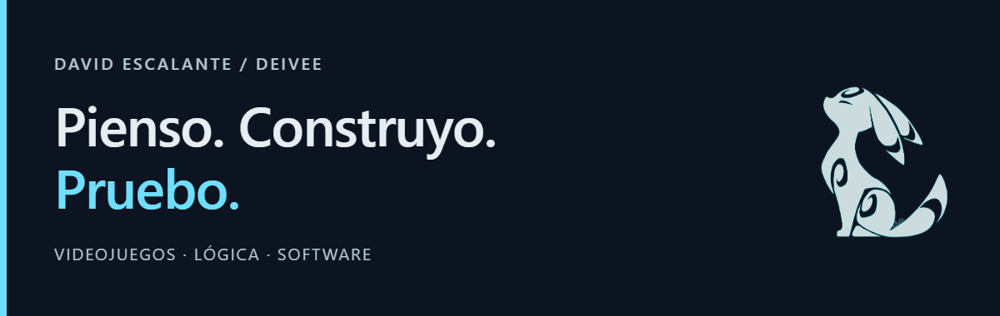
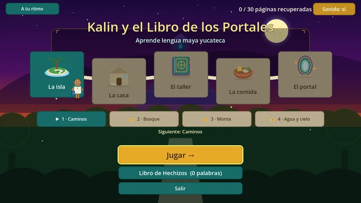
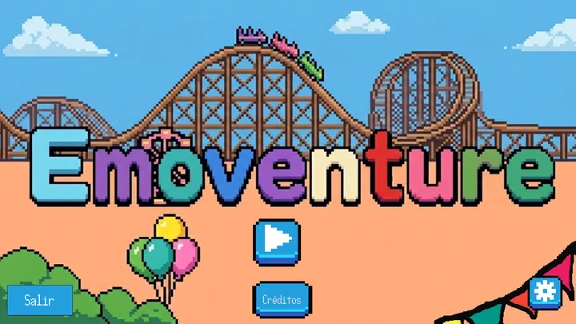
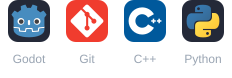

# Hola, soy David 👋

También puedes llamarme **Deivee**. Estudio Ingeniería de Software en la UADY y desarrollo videojuegos educativos con **Godot y GDScript**.

Me gusta crear mecánicas, entender por qué algo falla y construir soluciones que mejoren con cada prueba.

> Primer empleo desde **enero de 2027** · Cancún / remoto.
>  Mi foco: videojuegos. También me interesan software y pruebas.

## Proyectos seleccionados

<table>
  <tr>
    <td width="50%" valign="top">
      
      <h3><a href="https://github.com/ElRaizer/Kalin-Libro-De-Portales">Kalin</a></h3>
      
Tableros configurables, caminos que se pueden retomar y retos de memoria y escritura.

      Ampliación de un juego existente
    </td>
    <td width="50%" valign="top">
      
      <h3><a href="https://github.com/DavidEscalanteG/Emoventure">Emoventure</a></h3>
      
Personalización, perfiles en JSON y enemigos con rutas aleatorias conectadas.

      Desarrollo en equipo desde cero
    </td>
  </tr>
</table>

**También contribuyo a:** [El Gato Milaneso](https://github.com/DavidEscalanteG/Gato-Milaneso) — mantenimiento y reportes PDF; [Kiin](https://www.kiin.live/generador) — pruebas automatizadas; y **SGP** — persistencia con SQLite y pruebas de integridad.

Los proyectos son de equipo; las descripciones señalan mi participación.

## Herramientas que uso en proyectos

<picture>
  <source media="(prefers-color-scheme: light)" srcset="assets/tools-light.svg">
  <source media="(prefers-color-scheme: dark)" srcset="assets/tools-dark.svg">
  
</picture>

**En mis proyectos:** GDScript · JSON / SQLite · Jest / React Testing Library.

También he trabajado con **C++ y Python**.

Una pista sobre cómo pienso

Me gustan los rompecabezas, el ajedrez y los juegos donde puedo construir y entender cómo se conectan las piezas. Esa curiosidad también aparece al programar y depurar.

Bronce nacional en la Olimpiada Mexicana de Informática para Secundarias, 2019 · [Mi práctica en omegaUp](https://omegaup.com/profile/Deivee_Gamer/).

English · About me

I’m **David / Deivee**, a Software Engineering student at UADY, Mexico. I build educational games with **Godot and GDScript** and contribute to debugging, automated tests and data persistence.

My contributions include configurable boards and interaction improvements in **Kalin**, character customization and JSON profiles in **Emoventure**, maintenance and PDF fixes in **El Gato Milaneso**, automated tests in **Kiin**, and SQLite persistence and integrity tests in **SGP**. These are team projects; each description reflects my contribution.

I enjoy implementing mechanics, solving problems and learning from feedback. I am seeking my first role from **January 2027**, in **Cancún or remotely**, especially in game programming and also in software development or testing.

[Email](mailto:david.10.ernesto@gmail.com) · [LinkedIn](https://www.linkedin.com/in/david-escalante-garcia-b2a449352)

---

[Correo](mailto:david.10.ernesto@gmail.com) · [LinkedIn](https://www.linkedin.com/in/david-escalante-garcia-b2a449352) · Español / English
